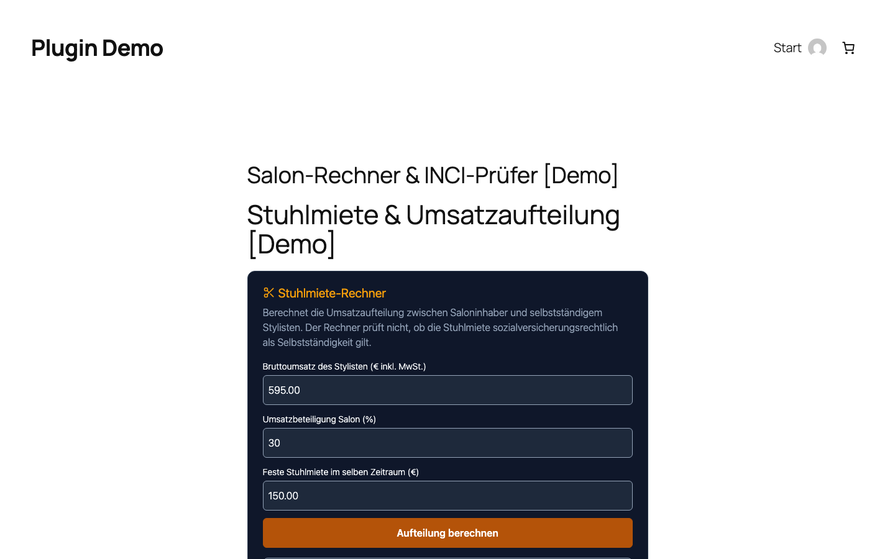
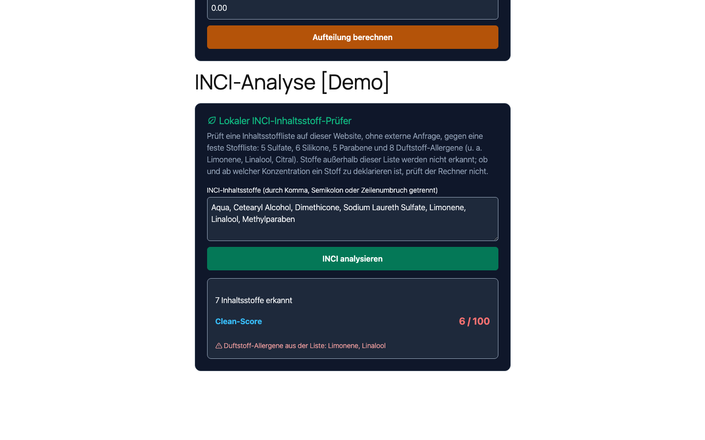
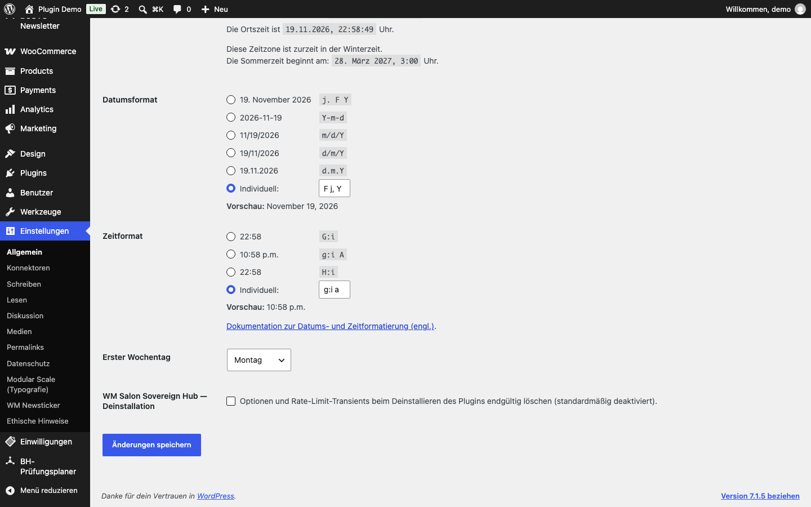

# WM Salon Sovereign Hub (Deutsche Dokumentation)

<p align="center">
  <a href="README.md"></a>
  <a href="README.de.md"></a>
  <a href="README.es.md"></a>
</p>

> **Zwei Rechner für Friseursalons: die Umsatzaufteilung bei Stuhlmiete zwischen Salon und selbstständigem Stylisten und ein INCI-Inhaltsstoff-Prüfer auf der eigenen Website — als Shortcodes, REST-Routen, WP-CLI-Befehle, Block Bindings und GenerateBlocks-Dynamic-Tags**  
> **Plugin-Seite:** [https://arnoldwender.com/wordpress-plugins/wm-salon-sovereign-hub/](https://arnoldwender.com/wordpress-plugins/wm-salon-sovereign-hub/)  
> **Mit einem agentischen Workflow entwickelt:** entstanden mit KI-Coding-Agenten. Prüfen und testen Sie es wie jeden fremden Code, bevor Sie es produktiv einsetzen.  
> **Support & Haftung:** Kein Support (Zero Support) — reproduzierbare Bugs ausschließlich über [GitHub Issues](https://github.com/arnoldwender/wm-wp-salon-sovereign-hub/issues) · kein privater Support · OHNE GEWÄHR („AS IS“) / keine Haftung ([SUPPORT.md](SUPPORT.md))

> Diese Datei beschreibt, was Version 1.2.1 tatsächlich ausliefert: zwei Shortcodes (`[wm_salon_stuhlmiete]` und `[wm_salon_inci_checker]`), zwei per IP-HMAC ratenbegrenzte REST-Routen unter `wm-salon/v1`, den WP-CLI-Befehl `wp salon` (`status`, `analyze-inci`, `calculate-rent`), WordPress-Block-Bindings (`wm-salon/metrics`), das GenerateBlocks-2.x-Dynamic-Tag (`{{wm_salon_metric}}`), Entwickler-Hooks, eine Opt-in-Einstellung für die Deinstallation (`wm_salon_delete_data_on_uninstall`) sowie 29 übersetzte `.po`/`.mo`-Sprachpakete.

---

## Live-Vorschau

!WM Salon Sovereign Hub Banner

| Stuhlmieten-Rechner | INCI-Prüfer | Deinstallations-Option |
|---|---|---|
|  |  |  |

---

## Was das Plugin leistet

1. **Stuhlmiete-Aufteilung:** `WM_Salon_Stuhlmiete_Ledger::calculate_split()` nimmt den Bruttoumsatz des Stylisten (inkl. MwSt.), die Umsatzbeteiligung des Salons als Anteil (auf 0–1 begrenzt), eine optionale feste Miete für denselben Zeitraum und den MwSt.-Satz (auf 0 bis 100 Prozent begrenzt). Jeder Betrag wird einmal auf ganze Cent gerundet, und jeder Rechenschritt läuft in ganzen Cent mit kaufmännischer Rundung. Ergebnis: Brutto- und Nettoumsatz, MwSt.-Betrag, Salon-Anteil (Prozentanteil plus feste Miete), Auszahlung an den Stylisten brutto und netto sowie `shortfall_gross`: um wie viel der Salon-Anteil den Umsatz übersteigt, wenn die feste Miete größer ist als der Rest (die Auszahlung ist dann 0). Ein Wert, der keine endliche Zahl ist, oder ein Betrag über 1 000 000 000 löst eine `InvalidArgumentException` aus.
2. **Zugänge zur Aufteilung:** Der Shortcode `[wm_salon_stuhlmiete]` ist ein Formular mit Bruttoumsatz, Salon-Anteil in Prozent (0–100) und fester Miete; die MwSt. beträgt im Formular fest 19 Prozent. `POST /wp-json/wm-salon/v1/stuhlmiete` nimmt `gross_revenue` (Pflicht), `rent_rate` (0–1, Standard 0,30), `fixed_rent` (Standard 0) und `vat_rate` (0–100, Standard 19); ein fehlender, nicht numerischer oder unzulässiger Wert ergibt 400. `wp salon calculate-rent --revenue=<EUR> [--rate=<anteil>] [--fixed=<EUR>] [--vat=<prozent>]` zeigt dieselben Zahlen und warnt bei einem Fehlbetrag.
3. **INCI-Prüfer:** `WM_Salon_INCI_Analyzer::analyze()` trennt eine Liste an Kommas, Semikolons und Zeilenumbrüchen — ein Komma in Klammern oder zwischen zwei Ziffern gehört zum Stoff, `Parfum (Limonene, Linalool)` und `1,2-Hexanediol` sind also je ein Stoff — und vergleicht jeden Stoff per Teilstring mit vier Stofflisten: 5 Sulfate, 6 Silikone, 5 Parabene und 8 Duftstoff-Allergene (Limonene, Linalool, Citral, Geraniol, Coumarin, Citronellol, Benzyl Alcohol, Eugenol; ob und ab welcher Konzentration einer davon auf einer Verpackung anzugeben ist, prüft das Plugin nicht). Ergebnis: Anzahl der Stoffe, die drei Ja/Nein-Befunde, die gefundenen Allergene, ein Clean-Score (100 minus Abzüge) und die Badges `SULFATFREI`, `SILIKONFREI`, `PARABENFREI`, `CLEAN_BEAUTY` (ab Score 80). Eine Liste ohne Stoff erhält kein Urteil (`null`, kein Badge).
4. **Zugänge & Ratenbegrenzung:** `[wm_salon_inci_checker]` ist ein Formular mit Textfeld. `POST /wp-json/wm-salon/v1/inci-check` nimmt `inci` (Pflichttext bis 64 KiB) und antwortet bei einer leeren oder zu langen Liste mit 400. Beide öffentlichen REST-Routen schützen sich über `WM_Salon_REST_Controller::check_public_access()` mittels IP-HMAC-SHA256-Transients (`wm_salon_rl_*`, Standard 60 Anfragen pro Minute, HTTP 429 bei Überschreitung), ohne Klartext-IPs zu speichern.
5. **Ökosystem & Hooks:** WordPress 6.5+ Block Bindings (`wm-salon/metrics`) und das GenerateBlocks 2.x Dynamic Tag (`{{wm_salon_metric}}`) stellen Salon-Kennzahlen bereit. Entwickler nutzen Filter (`wm_salon_stuhlmiete_calculation`, `wm_salon_inci_database`, `wm_salon_inci_result`, `wm_salon_rest_rate_limit`, `wm_salon_metric_value`) und Actions (`wm_salon_ready`, `wm_salon_rest_calculated`).
6. **WP-CLI & WM Suite Hub Spoke:** `wp salon status` zeigt Version, Zugänge und Deinstallationsrichtlinie. `includes/class-salon-spoke-adapter.php` meldet sich über `wm_register_suite_module` mit SBOM-Daten, SHA-256-Prüfsumme und `self_test`-Status.
7. **Frontend, i18n & Deinstallation:** `assets/css/wm-salon-hub.css` nutzt ausschließlich CSS-Variablen mit geprüften Kontrastwerten und 48-px-Zielgrößen. Alle 29 `.po`/`.mo`-Sprachkataloge in `languages/` sind übersetzt und kompiliert. Bei der Deinstallation bewahrt `uninstall.php` standardmäßig alle Daten und löscht Optionen sowie Rate-Limit-Transients nur nach explizitem Opt-in über `wm_salon_delete_data_on_uninstall` unter *Einstellungen → Allgemein*.

### Nicht enthalten

Kein Buchungskalender, keine Stylisten-Konten, keine Kundendatenbank, keine Rechnungsstellung; keine Chargen-Rückverfolgung; keine eigenen Datenbanktabellen; keine externen Anfragen; kein Frontend-Skript.

---

## Schnellstart

1. Plugin installieren und aktivieren (WordPress 6.4+, PHP 8.1+).
2. `[wm_salon_stuhlmiete]` und / oder `[wm_salon_inci_checker]` auf einer Seite einfügen.
3. Aus einer Integration `POST /wp-json/wm-salon/v1/stuhlmiete` oder `/inci-check` aufrufen; auf dem Server `wp salon calculate-rent --revenue=1190 --rate=0.30`.
4. Blöcke über `wm-salon/metrics` anbinden oder `{{wm_salon_metric key:substances_count}}` in GenerateBlocks 2.x verwenden.

Klassen, Routen, Hooks, Befehle und bekannte Einschränkungen: **[README.md](README.md)** (Referenz) und **[DEVELOPERS.md](DEVELOPERS.md)**.

```bash
php tests/test-suite.php        # Standalone-Prüfungen, ohne WordPress
php tests/test-pot-freshness.php # prüft die Vollständigkeit von languages/*.pot
bash tests/run-mutations.sh     # jede Korrektur einmal rückgängig gemacht; die Suite muss jedes Mal fehlschlagen
```

---

## Konformität

- **Keine externen Anfragen:** Umsatzzahlen und Inhaltsstofflisten werden auf der Website berechnet und nirgendwohin gesendet.
- **Datenschutz:** Eingaben der Rechner werden nicht gespeichert; das REST-Rate-Limiting speichert ausschließlich kurzlebige Zähler unter einem HMAC-SHA256-Hash der Client-IP.
- **Reichweite:** der Aufteilungsrechner prüft nicht, ob eine Stuhlmiete sozialversicherungsrechtlich als Selbstständigkeit gilt (§ 7 SGB IV), und erstellt keine Rechnung (§ 14 UStG); der INCI-Prüfer bewertet kein Produkt nach der Verordnung (EG) Nr. 1223/2009. Beide liefern Zahlen, keine rechtliche oder regulatorische Bewertung.

---

## Lizenz

Vertrieben unter der **GNU General Public License v2 oder neuer** (`GPL-2.0-or-later`).  
Copyright (C) 2026 Arnold Wender. Alle Rechte vorbehalten.  
