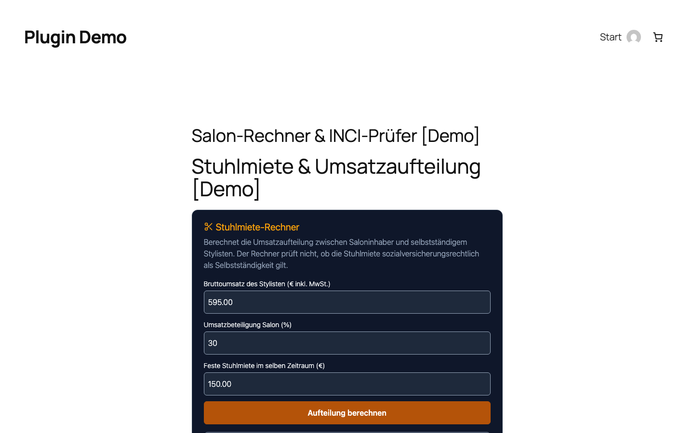
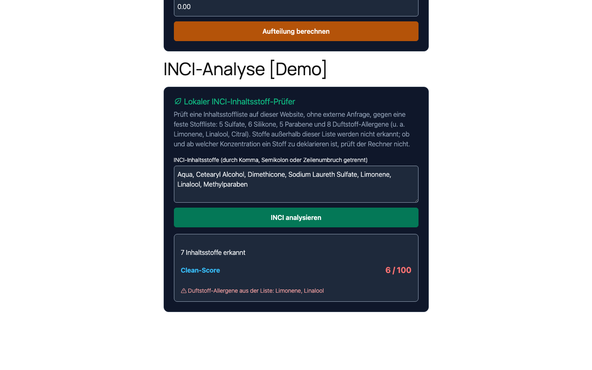
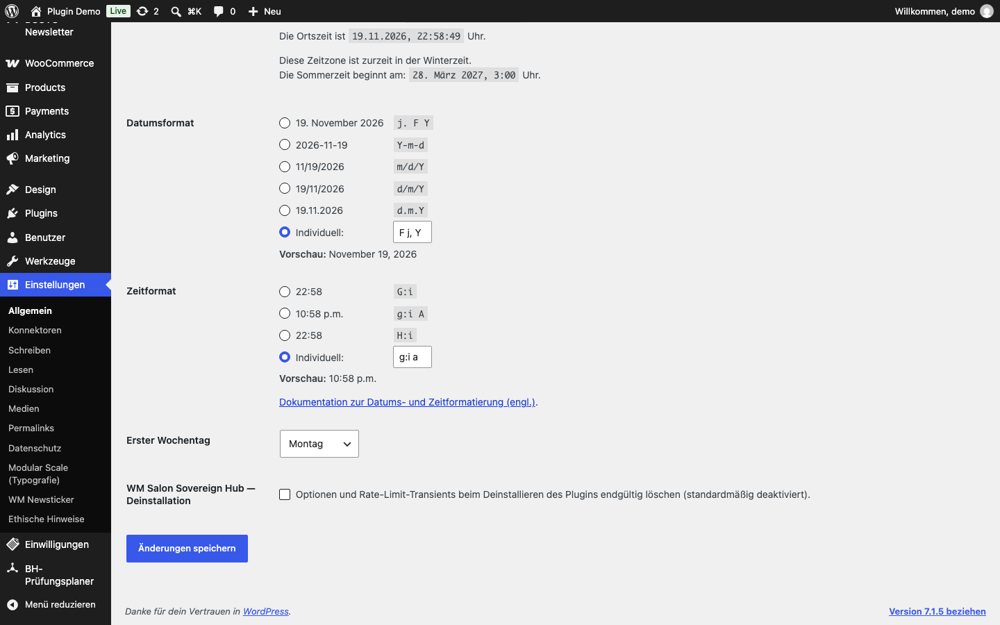

# WM Salon Sovereign Hub (Documentación en Español)

<p align="center">
  <a href="README.md"></a>
  <a href="README.de.md"></a>
  <a href="README.es.md"></a>
</p>

> **Dos calculadoras para peluquerías: el reparto de ingresos del alquiler de sillón (Stuhlmiete) entre el salón y un estilista independiente, y un verificador de ingredientes INCI en el propio sitio — como shortcodes, rutas REST, comandos WP-CLI, Block Bindings y etiquetas dinámicas de GenerateBlocks**  
> **Página del plugin:** [https://arnoldwender.com/es/plugins-wordpress/wm-salon-sovereign-hub/](https://arnoldwender.com/es/plugins-wordpress/wm-salon-sovereign-hub/)  
> **Desarrollado con un agentic workflow:** creado con agentes de programación de IA. Revísalo y pruébalo como cualquier código de terceros antes de usarlo en producción.  
> **Soporte y responsabilidad:** Cero soporte (Zero Support) — errores reproducibles únicamente en [GitHub Issues](https://github.com/arnoldwender/wm-wp-salon-sovereign-hub/issues) · sin soporte privado · TAL CUAL («AS IS») / sin responsabilidad ([SUPPORT.md](SUPPORT.md))

> Este archivo describe lo que entrega la versión 1.2.1 medida contra el código fuente: dos shortcodes (`[wm_salon_stuhlmiete]` y `[wm_salon_inci_checker]`), dos rutas REST bajo `wm-salon/v1` protegidas con límite de tasa por HMAC de IP, el comando `wp salon` (`status`, `analyze-inci`, `calculate-rent`), WordPress 6.5+ Block Bindings (`wm-salon/metrics`), etiqueta dinámica de GenerateBlocks 2.x (`{{wm_salon_metric}}`), hooks para desarrolladores, ajuste opt-in de desinstalación (`wm_salon_delete_data_on_uninstall`) y 29 catálogos `.po`/`.mo` traducidos.

---

## Capturas en vivo

!Banner de WM Salon Sovereign Hub

| Reparto de alquiler de sillón | Analizador INCI | Desinstalación opt-in |
|---|---|---|
|  |  |  |

---

## Qué hace el plugin

1. **Reparto del alquiler de sillón:** `WM_Salon_Stuhlmiete_Ledger::calculate_split()` toma la facturación bruta del estilista (IVA incluido), la participación del salón como fracción (limitada a 0–1), una renta fija opcional para el mismo periodo y el tipo de IVA (limitado de 0 a 100 por ciento). Redondea cada importe a céntimos una sola vez y calcula cada paso en céntimos enteros con redondeo comercial (la mitad hacia arriba). Devuelve ingresos brutos y netos, el importe de IVA, la parte del salón, el pago al estilista bruto y neto, y `shortfall_gross`: cuánto supera la parte del salón a la facturación cuando la renta fija excede el remanente (el pago es entonces 0). Un valor no finito o superior a 1 000 000 000 lanza `InvalidArgumentException`.
2. **Entradas del reparto:** el shortcode `[wm_salon_stuhlmiete]` es un formulario con facturación bruta, participación del salón (0–100) y renta fija; aplica el 19 por ciento de IVA. `POST /wp-json/wm-salon/v1/stuhlmiete` toma `gross_revenue` (obligatorio), `rent_rate` (0–1, por defecto 0,30), `fixed_rent` (por defecto 0) y `vat_rate` (0–100, por defecto 19); un valor ausente, no numérico o fuera de rango responde 400. `wp salon calculate-rent --revenue=<EUR> [--rate=<parte>] [--fixed=<EUR>] [--vat=<porcentaje>]` imprime las mismas cifras y avisa de un faltante.
3. **Verificador INCI:** `WM_Salon_INCI_Analyzer::analyze()` separa una lista por comas, punto y coma y saltos de línea — una coma dentro de paréntesis o entre dos dígitos sigue formando parte del ingrediente (`Parfum (Limonene, Linalool)`, `1,2-Hexanediol`) — y compara cada ingrediente por subcadena con cuatro listas: 5 sulfatos, 6 siliconas, 5 parabenos y 8 alérgenos de fragancia (limonene, linalool, citral, geraniol, coumarin, citronellol, benzyl alcohol, eugenol; los umbrales de concentración en etiquetado no se comprueban). Devuelve el total de ingredientes, los tres hallazgos sí/no, los alérgenos detectados, una puntuación «clean» y las insignias `SULFATFREI`, `SILIKONFREI`, `PARABENFREI`, `CLEAN_BEAUTY` (puntuación 80 o superior). Una lista vacía recibe `null` y ninguna insignia.
4. **Entradas INCI y límite de tasa:** `[wm_salon_inci_checker]` muestra un área de texto y presenta el análisis debajo del formulario. `POST /wp-json/wm-salon/v1/inci-check` exige `inci` (hasta 64 KiB) y responde 400 ante listas vacías o excesivas. Ambas rutas REST aplican `WM_Salon_REST_Controller::check_public_access()` mediante transitorios con hash HMAC-SHA256 de la IP (`wm_salon_rl_*`, 60 peticiones por minuto por defecto, HTTP 429 al superarlo) sin guardar IPs en claro.
5. **Ecosistema y hooks:** fuente Block Bindings `wm-salon/metrics` (WordPress 6.5+) y etiqueta dinámica `{{wm_salon_metric}}` para GenerateBlocks 2.x. Filtros: `wm_salon_stuhlmiete_calculation`, `wm_salon_inci_database`, `wm_salon_inci_result`, `wm_salon_rest_rate_limit`, `wm_salon_metric_value`; acciones: `wm_salon_ready`, `wm_salon_rest_calculated`.
6. **WP-CLI y Spoke de WM Suite Hub:** `wp salon status` imprime la versión, las entradas y la política de desinstalación. `includes/class-salon-spoke-adapter.php` expone SBOM CycloneDX, hash SHA-256 y estado medido mediante `self_test`.
7. **Frontend, i18n y desinstalación opt-in:** `assets/css/wm-salon-hub.css` emplea solo variables CSS con contraste verificado y objetivos de 48 px. Los 29 catálogos `.po`/`.mo` en `languages/` están traducidos y compilados. Al desinstalar, `uninstall.php` conserva todos los datos salvo que el administrador active expresamente `wm_salon_delete_data_on_uninstall` en *Ajustes → Generales*.

### No incluido

Sin calendario de reservas, cuentas de estilistas, base de clientes ni facturación; sin trazabilidad de lotes; sin tablas propias; sin peticiones externas; sin JavaScript en el frontend.

---

## Inicio rápido

1. Instala y activa el plugin (WordPress 6.4+, PHP 8.1+).
2. Coloca `[wm_salon_stuhlmiete]` y / o `[wm_salon_inci_checker]` en una página.
3. Llama a `POST /wp-json/wm-salon/v1/stuhlmiete` o `/inci-check`, o ejecuta `wp salon calculate-rent --revenue=1190 --rate=0.30`.
4. Vincula bloques mediante `wm-salon/metrics` o usa `{{wm_salon_metric key:substances_count}}` en GenerateBlocks 2.x.

Clases, rutas, hooks, comandos y limitaciones conocidas: **[README.md](README.md)** (referencia) y **[DEVELOPERS.md](DEVELOPERS.md)**.

```bash
php tests/test-suite.php        # comprobaciones standalone, sin WordPress
php tests/test-pot-freshness.php # verifica la frescura de languages/*.pot
bash tests/run-mutations.sh     # cada corrección se deshace una vez; la suite debe fallar cada vez
```

---

## Conformidad

- **Sin peticiones externas:** las cifras de facturación y las listas de ingredientes se calculan en el sitio y no se envían a ningún lado.
- **Privacidad:** los importes y listas introducidos no se guardan; el límite de tasa REST aplica HMAC-SHA256 sobre la IP antes de guardar contadores temporales.
- **Alcance:** la calculadora de reparto no evalúa si un alquiler de sillón es trabajo autónomo real (§ 7 SGB IV) ni emite una factura (§ 14 UStG); el verificador INCI no evalúa un producto conforme al Reglamento (CE) n.º 1223/2009. Ambas dan cifras, no dictámenes legales ni regulatorios.

---

## Licencia

Distribuido bajo la **GNU General Public License v2 o posterior** (`GPL-2.0-or-later`).  
Copyright (C) 2026 Arnold Wender. Todos los derechos reservados.  
