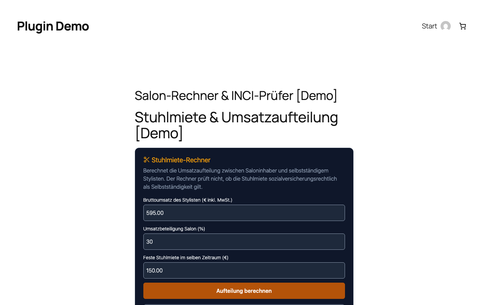

# WM Salon Sovereign Hub (Latviešu)

  [🇧🇬 Български](README.bg.md) • [🇨🇿 Čeština](README.cs.md) • [🇩🇰 Dansk](README.da.md) • [🇩🇪 Deutsch](../../README.de.md) • [🇬🇷 Ελληνικά](README.el.md) • [🇬🇧 English](../../README.md) • [🇪🇸 Español](../../README.es.md) • [🇪🇪 Eesti](README.et.md) • [🇫🇮 Suomi](README.fi.md) • [🇫🇷 Français](README.fr.md) • [🇮🇪 Gaeilge](README.ga.md) • [🇭🇷 Hrvatski](README.hr.md) [🇭🇺 Magyar](README.hu.md) • [🇮🇹 Italiano](README.it.md) • [🇱🇹 Lietuvių](README.lt.md) • [🇱🇻 Latviešu](README.lv.md) • [🇲🇹 Malti](README.mt.md) • [🇳🇱 Nederlands](README.nl.md) • [🇵🇱 Polski](README.pl.md) • [🇵🇹 Português](README.pt.md) • [🇷🇴 Română](README.ro.md) • [🇸🇰 Slovenčina](README.sk.md) • [🇸🇮 Slovenščina](README.sl.md) • [🇸🇪 Svenska](README.sv.md)

---

  
  
  
  
  

> **Two calculators for hair salons: the booth-rent (Stuhlmiete) revenue split between a salon and an independent stylist, and an on-site INCI ingredient checker — as shortcodes, REST routes, WP-CLI commands, Block Bindings and GenerateBlocks dynamic tags**  
> **Spraudņa lapa:** [https://arnoldwender.com/en/wordpress-plugins/wm-salon-sovereign-hub/](https://arnoldwender.com/en/wordpress-plugins/wm-salon-sovereign-hub/)  
> **Izstrādāts ar aģentisku darbplūsmu:** veidots ar mākslīgā intelekta programmēšanas aģentiem. Pārbaudiet un testējiet to kā jebkuru trešās puses kodu, pirms izmantojat to ražošanā.  
> **Support & Liability:** Zero support — reproducible bugs on [GitHub Issues](https://github.com/arnoldwender/wm-wp-salon-sovereign-hub/issues) only · no private support · AS IS / no liability ([SUPPORT.md](../../SUPPORT.md))

---

## 📸 Latviešu Enterprise Showcase

!WM Salon Sovereign Hub Banner

---

## 🟢 1. LĪMENIS: ĀTRĀS DARBA SĀKŠANAS ROKASGRĀMATA IESĀCĒJIEM (NO-CODE)

### Ko šis spraudnis sniedz jūsu vietnei?
Two calculators for hair salons: the booth-rent (Stuhlmiete) revenue split between a salon and an independent stylist, and an on-site INCI ingredient checker — as shortcodes, REST routes, WP-CLI commands, Block Bindings and GenerateBlocks dynamic tags

### 🚀 Kā sākt 2 minūtēs (Soli pa solim bez koda):
1. Install and activate the plugin (WordPress 6.4+, PHP 8.1+).
2. Place `[wm_salon_stuhlmiete]` and / or `[wm_salon_inci_checker]` on a page. Each form posts back to the same page and prints its result below the form.
3. Call `POST /wp-json/wm-salon/v1/stuhlmiete` with `gross_revenue` and `rent_rate` (`0.30`), or `/inci-check` with `inci`; on the server, run `wp salon calculate-rent --revenue=1190 --rate=0.30`.
4. Bind core blocks via `wm-salon/metrics` or insert `{{wm_salon_metric key:substances_count}}` in GenerateBlocks 2.x.

### 💡 Biežāk uzdotie jautājumi iesācējiem:
#### ❓ What is not included?
No dedicated salon booking calendar, stylist account management, client database or invoicing; no cosmetic batch tracking; no custom database tables; no external network requests; no frontend JavaScript dependency.

---

## 🟡 2. LĪMENIS: TĪMEKĻA PĀRZIŅU UN ADMINISTRATORU ROKASGRĀMATA

### What the plugin does
1. **Booth-rent split.** `WM_Salon_Stuhlmiete_Ledger::calculate_split( gross, rate, fixed, vat )` takes a stylist's gross turnover (VAT included), the salon's share as a fraction (clamped to 0–1), an optional fixed rent for the same period and a VAT rate (clamped to 0 to 100 percent). It rounds each amount to whole cents once and computes every step in integer cents with commercial rounding (half up), so a 0.30 share on a sub-euro amount rounds identically on every PHP version. It returns gross and net revenue, the VAT amount, the salon's share (percentage share plus fixed rent), the stylist's payout gross and net, and `shortfall_gross`: by how much the salon's share exceeds the turnover when the fixed rent is larger than what is left (the payout is then 0). A value that is not a finite number, or an amount above the 1 000 000 000 limit, throws `InvalidArgumentException`.
2. **Split front doors.** The shortcode `[wm_salon_stuhlmiete]` is a form with gross turnover, the salon's share in percent (0–100) and a fixed rent; VAT is fixed at 19 percent. It keeps the entered values, prints the split below the form with a message when the fixed rent exceeds the turnover, and asks for valid amounts instead of computing with 0. `POST /wp-json/wm-salon/v1/stuhlmiete` takes `gross_revenue` (required), `rent_rate` (0–1, default 0.30), `fixed_rent` (default 0) and `vat_rate` (0 to 100, default 19); a missing, non-numeric or out-of-range value answers 400. `wp salon calculate-rent --revenue=<EUR> [--rate=<share>] [--fixed=<EUR>] [--vat=<percent>]` prints the same figures and warns about a shortfall.
3. **INCI ingredient checker.** `WM_Salon_INCI_Analyzer::analyze( "Aqua, …" )` splits a list on commas, semicolons and line breaks — a comma inside parentheses or between two digits stays part of the ingredient, so `Parfum (Limonene, Linalool)` and `1,2-Hexanediol` are one ingredient each — and matches each ingredient against four substance lists by substring: 5 sulfates, 6 silicones, 5 parabens and 8 fragrance allergens (limonene, linalool, citral, geraniol, coumarin, citronellol, benzyl alcohol, eugenol; whether and above which concentration one of them must be listed on packaging is not checked). It returns the ingredient count, the three yes/no findings, the allergens found (each once, named as in the list), a clean score (100 minus 30 for sulfates, 20 for silicones, 40 for parabens, 2 per allergen up to 10) and the badges `SULFATFREI`, `SILIKONFREI`, `PARABENFREI`, `CLEAN_BEAUTY` (score 80 or above). A list without any ingredient gets no verdict: findings and score `null`, no badge.
4. **INCI front doors.** `[wm_salon_inci_checker]` is a form with a text area; it prints the number of ingredients recognised, the score, the badges and the allergens found, or says that the list holds no ingredient. `POST /wp-json/wm-salon/v1/inci-check` takes `inci` (a required string up to 64 KiB) and answers 400 for an oversized or empty ingredient list; `wp salon analyze-inci "<ingredients>"` ends with an error for an empty list.
5. **REST IP-HMAC rate-limiting.** Both public `wm-salon/v1` endpoints run `WM_Salon_REST_Controller::check_public_access()`, which hashes the client IP with `hash_hmac( 'sha256', ... )` keyed by the WordPress auth salt and tracks request counts in short-lived transients (`wm_salon_rl_*`, default 60 requests per minute, HTTP 429 when exceeded). No raw IP address is stored.
6. **Ecosystem & developer extensibility.** WordPress 6.5+ Block Bindings source `wm-salon/metrics` and GenerateBlocks 2.x Dynamic Tag `{{wm_salon_metric}}` expose salon figures (`version`, `substances_count`, `salon_share_gross`, `stylist_payout_gross`, etc.) to blocks and templates. Developers can hook into `wm_salon_stuhlmiete_calculation`, `wm_salon_inci_database`, `wm_salon_inci_result`, `wm_salon_rest_rate_limit`, `wm_salon_metric_value`, `wm_salon_ready` and `wm_salon_rest_calculated`.
7. **WP-CLI & WM Suite Hub spoke.** `wp salon status` prints the version, entry points and uninstallation policy. `includes/class-salon-spoke-adapter.php` registers through `wm_register_suite_module` with a CycloneDX SBOM component, SHA-256 hash of the main file and measured `self_test` health.
8. **Front end, i18n & opt-in uninstallation.** Both forms enqueue `assets/css/wm-salon-hub.css` only when rendered (custom properties only, WCAG contrast ratios verified in tests, 48px targets, visible focus ring). `languages/` ships `wm-salon-sovereign-hub.pot` and 29 compiled `.po`/`.mo` catalogs. On uninstallation, `uninstall.php` preserves all options and transients by default unless `wm_salon_delete_data_on_uninstall` is explicitly enabled under *Settings → General*.

### Not shipped
No dedicated salon booking calendar, stylist account management, client database or invoicing; no cosmetic batch tracking; no custom database tables; no external network requests; no frontend JavaScript dependency.

---

## 🔴 3. LĪMENIS: IZSTRĀDĀTĀJU UN PROGRAMMATŪRAS ARHITEKTU ROKASGRĀMATA

Classes, hooks, options, the admin screen and the WM Suite Hub adapter are documented in the English manual: **[DEVELOPERS.md](../../DEVELOPERS.md)**.

---

## ⚖️ Eiropas normatīvo aktu atbilstība

- **Zero external requests:** revenue figures and ingredient lists are computed on the site and never sent anywhere.
- **Privacy:** calculator inputs are never stored; REST rate-limiting hashes client IPs with HMAC-SHA256 before writing short-lived counter transients.
- **Scope:** the split calculator does not assess whether a booth rental is genuine self-employment (§ 7 SGB IV) or produce an invoice (§ 14 UStG); the INCI checker does not assess a product under Regulation (EC) No 1223/2009. Both give figures, not legal or regulatory verdicts.

---

## 🔒 Licence un īpašumtiesības

Distributed under the **GNU General Public License v2 or later**.  
Copyright (C) 2026 Arnold Wender.  
